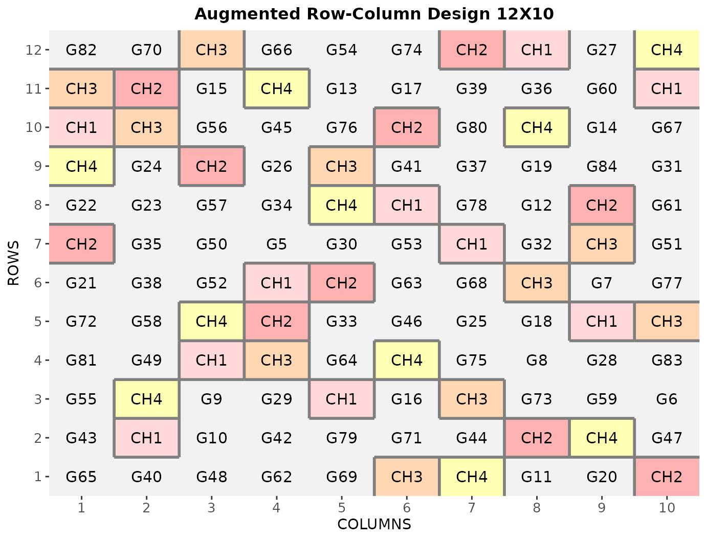
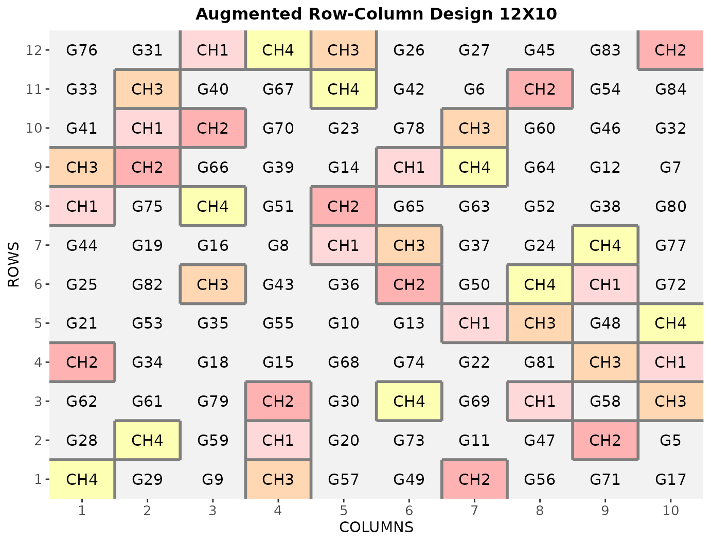

# Augmented Row-Column Design

This vignette shows how to generate an **augmented row-column design**
using both the FielDHub Shiny App and the scripting function
[`augmented_row_column()`](https://didiermurillof.github.io/FielDHub/reference/augmented_row_column.md)
from the `FielDHub` package.

### Overview

In early-generation trials there is usually seed for only one plot of
each test entry. Augmented designs replicate a small number of checks
across the field so that field trends and the residual variance can be
estimated and the unreplicated tests can be compared.

An augmented row-column design controls field variation in two
directions, rows and columns, in one complete rectangular field. In
FielDHub’s version every check appears exactly once in every field line
along one direction (every column, or every row), and every test entry
appears exactly once.

FielDHub already offers two check-based designs.
[`RCBD_augmented()`](https://didiermurillof.github.io/FielDHub/reference/RCBD_augmented.md)
blocks in one direction, and
[`diagonal_arrangement()`](https://didiermurillof.github.io/FielDHub/reference/diagonal_arrangement.md)
places checks in a systematic diagonal pattern.
[`augmented_row_column()`](https://didiermurillof.github.io/FielDHub/reference/augmented_row_column.md)
places the checks so that both row and column effects are estimable and
then searches the check positions under a chosen statistical criterion.

Features include the field dimensions, the number of checks (or the
check labels), test labels or an uploaded entry list, the check
direction, one of three search criteria, multiple locations, serpentine
or cartesian plot numbering, and reproducible results from a recorded
seed.

### Attribution

**The construction** is that of Piepho and Williams (2026): an augmented
row-column design generated from a small auxiliary array called a
*contraction*. They show that the efficiency of the contraction and of
the augmented design are closely linked, so a design can be described
and searched through the small contraction rather than the whole field.

**The square-array foundation** is Bailey and Haines (2025): square
fields ($`v = s`$) represented through a $`k \times t`$ auxiliary block
design, with results on connectedness and randomization. Square fields
in FielDHub include these square-array designs.

**FielDHub’s own contribution** is the search for the check positions,
the restricted placement rules adopted here, the orientation handling,
the field book and the app. The search described below is FielDHub’s own
method. It is not part of the published construction, and the published
articles are not responsible for it.

All computation is FielDHub code. No published design is copied into the
package; published layouts are cited only as literature.

### The method

#### Notation

The method works in a *mathematical* orientation with $`v`$ rows and
$`s`$ columns, in which each check appears once in every mathematical
column. The section on the check direction explains how this maps to
physical field rows and columns.

| Symbol | Meaning |
|----|----|
| $`v`$ | Plots in each line along the check direction (mathematical rows) |
| $`s`$ | Lines along the check direction (mathematical columns) |
| $`k`$ | Number of checks, $`2 \le k < v`$ |
| $`n = vs`$ | Number of plots |
| $`T = (v - k)s`$ | Number of test entries, each on one plot |
| $`v^* = T + k`$ | Number of treatments (tests plus checks) |
| $`u`$ | Replications: 1 for each test, $`s`$ for each check |
| $`r_h`$ | Number of check plots in mathematical row $`h`$ |

Every check occupies $`s`$ plots, so the checks take $`ks`$ plots and
the tests the remaining $`(v-k)s`$.

#### The contraction

The check positions are described by a $`k \times s`$ matrix $`L`$, the
contraction. Its entry $`L_{ij} \in \{1, \dots, v\}`$ is the row that
holds check $`i`$ in column $`j`$. Expanding $`L`$ places check $`i`$ at
field cell $`(L_{ij}, j)`$; the test entries fill the other $`T`$ cells
(Piepho and Williams 2026).

Reading the columns of $`L`$ as blocks, $`L`$ is a small block design
for $`v`$ “pseudo-treatments” (the field rows) in $`s`$ blocks of size
$`k`$. For square fields this is the auxiliary block design of Bailey
and Haines (2025).

FielDHub enforces a **restricted placement**. This is the restricted
mode adopted for FielDHub, matching the binary contractions of Piepho
and Williams (2026):

- $`s \le v`$;
- no repeat within a column of $`L`$: two checks never share a plot;
- no repeat within a row of $`L`$: no check appears twice in the same
  mathematical row;
- balanced row loads: every $`r_h \ge 1`$ and
  $`r_h \in \{\lfloor ks/v \rfloor, \lceil ks/v \rceil\}`$, with
  $`\sum_h r_h = ks`$. In words: every cross-line carries between
  $`\lfloor ks/v \rfloor`$ and $`\lceil ks/v \rceil`$ check plots, at
  least one.

Other placements, such as letting a check repeat within a cross-line,
are not offered.

#### Model

``` math
y = X\tau + Z_R\rho + Z_C\gamma + \varepsilon, \qquad \varepsilon \sim N(0, \sigma^2 I),
```

with fixed treatment effects $`\tau`$ (tests and checks), fixed row
effects $`\rho`$, fixed column effects $`\gamma`$ and independent
errors. $`X`$ ($`n \times v^*`$), $`Z_R`$ ($`n \times v`$) and $`Z_C`$
($`n \times s`$) are the plot-level design matrices.

The treatment information matrix is

``` math
C = \operatorname{diag}(u) - \frac{1}{s} M_R M_R^\mathsf{T} - \frac{1}{v} M_C M_C^\mathsf{T} + \frac{1}{n} u u^\mathsf{T}, \qquad M_R = X^\mathsf{T} Z_R, \quad M_C = X^\mathsf{T} Z_C.
```

All variances are reported in units of $`\sigma^2`$: for treatments
$`a`$ and $`b`$,

``` math
\operatorname{Var}(\hat\tau_a - \hat\tau_b)/\sigma^2 = (e_a - e_b)^\mathsf{T} C^{-} (e_a - e_b),
```

where $`e_a`$ is the $`a`$-th unit vector and $`C^{-}`$ a generalized
inverse of $`C`$.

#### Connectivity and residual degrees of freedom

A design is *connected* when every treatment comparison is estimable.
FielDHub decides this from the eigenvalues of an information matrix, not
from a pivoted QR rank, and a design that is not connected is never
scored or returned.

A connected design has

``` math
\mathrm{df} = ks - k - v - s + 2
```

residual degrees of freedom (the $`n`$ plots minus the
$`v^* + (v - 1) + (s - 1)`$ estimated effects). It depends only on
$`v`$, $`s`$ and $`k`$, never on where the checks are placed.

Fields with $`\mathrm{df} < 1`$ are rejected before any search: the
residual variance could not be estimated. The section on residual
degrees of freedom covers fields with fewer than 10.

#### How FielDHub searches the check positions

The search works on the contraction $`L`$, not on the full field. It
keeps every candidate within the restricted placement rules and discards
candidates that are not connected.

The available method is `method = "staged"`: staged annealing with
recoloring restarts. Each restart:

- starts from a random balanced contraction;
- anneals the column composition of $`L`$ (which rows each column uses),
  scored by a fast column-design efficiency proxy;
- re-arranges the rows of $`L`$ by several random *recolorings*
  (re-assignments of which check takes which row within each column,
  keeping the column composition) and anneals the row arrangement under
  the chosen objective;
- anneals rows and columns jointly under the chosen objective;
- finishes with a short local polish that accepts only improvements.

In square fields ($`v = s`$) every row arrangement gives the same
objective value, so the row phase is skipped and its share goes to the
column phase.

**Budget.** `budget` is the number of objective-function calls allowed
per location, shared by all restarts and phases; proxy calls count
against it too. The search stops when the budget is spent. Final scoring
of the returned design is outside the budget. The internal parameters
(restarts, recolorings, phase shares, temperatures) are fixed by the
package and are not user settings. When `budget` is not given, a default
budget that depends on the field size is used; the rule is stated in
[`?augmented_row_column`](https://didiermurillof.github.io/FielDHub/reference/augmented_row_column.md).

**No silent fallback.** If no connected starting design is found within
a bounded number of tries, or the budget or time limit runs out before
any design is produced, the function stops with a
`fieldhub_arc_search_error`; it never switches to another method.

Only `"staged"` is accepted.

The search returns the best design it found within the budget; it does
not prove that no better design exists.

#### Randomization

After the search, from the same seed stream:

- the mathematical rows and columns are permuted uniformly at random;
- the $`k`$ check labels receive one global random permutation;
- the test entries are assigned to the test plots by a uniform random
  permutation;
- the result is mapped to physical `ROW` and `COLUMN`.

Check occurrences are never shuffled one by one, because that could
break the placement rules. None of these steps changes any objective
value. Uniform row and column permutations give a valid randomization in
the sense discussed by Bailey and Haines (2025) (their Section 3.3). The
returned `contraction` and `statistics` describe the final, randomized
placement, not the search’s internal output.

### Search objectives

The search optimizes one of three criteria, chosen with `objective`. All
three, plus the check-versus-check variance and the two worst-case
variances, are reported for every location whichever is optimized.

| `objective` | Definition | Direction |
|----|----|----|
| `"V_tt"` | Mean of $`\operatorname{Var}(\hat\tau_a - \hat\tau_b)/\sigma^2`$ over all $`\binom{T}{2}`$ pairs of test entries | Minimize |
| `"V_tc"` | Mean over all $`Tk`$ test-versus-check pairs | Minimize |
| `"E_aug"` | Harmonic mean of the $`v^* - 1`$ nonzero eigenvalues of $`A^* = \operatorname{diag}(u)^{-1/2}\, C \operatorname{diag}(u)^{-1/2}`$: the average efficiency factor of Piepho and Williams (2026) | Maximize |

Reported only: `V_cc` (mean over the check pairs), `max_tt` and `max_tc`
(largest test-versus-test and test-versus-check variance).

- `V_tt` is the precision of comparisons among unreplicated entries, the
  usual purpose of a selection trial.
- `V_tc` is the precision of comparing entries with the standard checks.
- `E_aug` is the average efficiency relative to a completely randomized
  design with the same replications.

The criteria are related by

``` math
\frac{n(v^* - 1)}{E_{\mathrm{aug}}} = \sum_{i<j} u_i u_j \operatorname{Var}(\hat\tau_i - \hat\tau_j)/\sigma^2 .
```

`E_aug` therefore weights each test-versus-test pair by 1, each
test-versus-check pair by $`s`$ and each check-versus-check pair by
$`s^2`$, so it emphasizes comparisons involving checks more than `V_tt`
does.

In square row- and column-binary designs the three criteria rank designs
identically (Bailey and Haines 2025). In rectangular fields they can
rank two designs differently, which is why all three are reported.

The default objective is currently `"V_tt"`. Pass `objective` and
`budget` explicitly when a result must be reproducible across package
versions. Reproduction code always records both.

### Check direction

`check_direction` is required, with no default. It names the physical
direction along which every check appears once per line:

- `"columns"`: each check appears once in every field column, so $`v`$ =
  `nrows` and $`s`$ = `ncols`;
- `"rows"`: each check appears once in every field row, so $`v`$ =
  `ncols` and $`s`$ = `nrows`.

The choice is never inferred from the field shape and the field is never
turned silently. It is recorded in `infoDesign`, in the recorded
parameters and in the `CHECK_DIRECTION` column of the field book.

The design needs $`s \le v`$. A field and direction with $`s > v`$ are
rejected before any random number is drawn, with an error naming the
other direction (see the examples below).

Choose the direction along which you want every check represented in
every line, for example along the planting or harvesting pass.

`ROW` and `COLUMN` in the field book are always the physical field
coordinates. Because the field book also carries `CHECK_DIRECTION`, a
CSV export alone is enough to recompute the orientation and verify that
each check appears once per line.

### Residual degrees of freedom

- $`\mathrm{df} < 1`$: rejected (no residual variance estimate).
- $`1 \le \mathrm{df} < 10`$: allowed, with a warning
  (`fieldhub_arc_low_df_warning`) at construction, and a persistent
  notice printed by [`print()`](https://rdrr.io/r/base/print.html) and
  [`summary()`](https://rdrr.io/r/base/summary.html) every time.

The warning states the df and, under independent normal errors, the
relative standard deviation of the residual-variance estimate,
$`\sqrt{2/\mathrm{df}}`$ (about 82% at 3 df, 45% at 10 df).

Only adding a check or changing the number of rows or columns raises the
residual degrees of freedom. Because df depends only on $`v`$, $`s`$ and
$`k`$, a longer search or another objective never changes it.

For example, the 12 × 8 field with three checks in the upload example
below has $`\mathrm{df} = 3 \cdot 8 - 3 - 12 - 8 + 2 = 3`$. This field
geometry is one tabulated by Piepho and Williams (2026) (their Table 1).

### Use case

A breeding program needs to test 80 lines with four checks at two
locations, FARGO and CASSELTON, in a field of 12 rows and 10 columns at
each location. Every check must appear once in every field column. The
field has $`12 \times 10 = 120`$ plots: each of the four checks takes
one plot in each of the 10 columns (40 check plots), and the 80 lines
fill the remaining plots. The design has
$`4 \cdot 10 - 4 - 12 - 10 + 2 = 16`$ residual degrees of freedom.

### Running the Shiny App

To launch the app you need to run either

``` r

FielDHub::run_app()
```

or

``` r

library(FielDHub)
run_app()
```

### 1. Using the FielDHub Shiny App

Once the app is running, go to **Unreplicated Designs** \> **Augmented
Row-Column**.

### Inputs

1.  **Import entries’ list?** `No` generates labels from the counts.
    `Yes` uploads a `.csv` file with exactly the columns `ENTRY` and
    `NAME` (as for the diagonal arrangement): `ENTRY` distinct positive
    whole numbers, `NAME` distinct non-blank labels, the checks in the
    first rows. The file must have one row per check plus one row per
    test plot. This example shows the format with three checks and the
    first seven lines; a real file has one row per test plot.

| ENTRY | NAME     |
|------:|:---------|
|     1 | Check-1  |
|     2 | Check-2  |
|     3 | Check-3  |
|     4 | Line 001 |
|     5 | Line 002 |
|     6 | Line 003 |
|     7 | Line 004 |
|     8 | Line 005 |
|     9 | Line 006 |
|    10 | Line 007 |

2.  **Input \# of Rows:** and **Input \# of Columns:** the field size
    (12 and 10 in the use case).
3.  **Input \# of Entries:** the number of test entries (shown only
    without an upload). It must equal the number of test plots, $`T`$ =
    rows × columns − checks × $`s`$ (80).
4.  **Input \# of Checks:** the number of checks, at least 2 (4).
5.  **Each check appears once in every:** `column` or `row`. No default:
    it must be chosen (`column`).
6.  **Search objective:** `V_tt: test versus test variance`,
    `V_tc: test versus check variance` or
    `E_aug: efficiency of all comparisons`. The value selected when the
    page opens is the default, `V_tt`.
7.  **Input \# of Locations:** and the location names (2;
    `FARGO, CASSELTON`).
8.  **Plot Order Layout:** `serpentine` or `cartesian`.
9.  **Starting Plot Number:**, **Input Experiment Name:**, **Random
    Seed:** as in the other spatial designs (one starting plot per
    location, comma separated).
10. **Year (blank = current):** the `YEAR` column; the effective year is
    recorded.
11. **Show advanced search options**: reveals **Search budget per
    location (blank = default):** and **Time limit per location in
    seconds (blank = none):**. A blank budget uses the size-based
    default, and a time limit makes replay timing-dependent (see
    “Reproducing a design”).

Then, click **Run!**, then **Randomize!**. While the search runs the
active tab shows “Searching for a balanced design…”; a field-scale
search can take tens of seconds per location.

### Outputs

After you run an augmented row-column design in FielDHub, the results
are displayed in these tabs:

- **Get Random**: the run controls and the design summary, which
  includes the per-location statistics and any low-df notice.
- **Data Input**: the list of entries and the table of checks.
- **Field Layout**: checks colored by check and tests in a neutral
  color, with PNG, PDF and CSV buttons at the top right.
- **Plot Number Field**: the plot numbers laid out over the field.
- **Field Book**: the full table, with the `CHECK_DIRECTION` column;
  downloadable as plain CSV.
- **Heatmap**: simulated data, as on the other spatial pages.

The design can be downloaded as a saved result (RDS) or as a standalone
R script; the section “Reproducing a design” explains what the script
reproduces.

### 2. Using the `FielDHub` function: `augmented_row_column()`

First, load the package.

``` r

library(FielDHub)
```

#### Inputs of `augmented_row_column()`

- `checks`: a count $`k \ge 2`$ gives labels `CH1`, …, `CHk`; or a
  character vector of at least two distinct, non-missing, non-blank
  labels, used in that order.
- `entries`: `NULL` (default) fills every test plot with labels
  `G(k+1)`, …, `G(k+T)`; a count must equal $`T`$ and gives the same
  labels; a character vector of distinct labels must have length $`T`$.
- Check and test labels must differ. Labels are kept exactly as given,
  including spaces and punctuation, and are compared exactly.
- `data`: an entry table with exactly the columns `ENTRY | NAME`. With
  `data`, `checks` must be the count $`k`$ (the first $`k`$ rows are the
  checks), and `entries` must be `NULL`; supplying both is an error
  naming the conflict, never a silent choice. The table must have
  $`k + T`$ rows.
- `ENTRY` in the field book: `1..k` for checks and `k+1..k+T` for tests
  without `data`; the uploaded values with `data`.
- `exptName` defaults to `"Expt1"`, `year` to the current year,
  `locationNames` to `1..l`; the effective values are recorded, so a
  later replay reproduces them.

Then, you can enter the information describing the above design like
this. A small `budget` keeps this example fast; the objective and method
are given explicitly so the example does not depend on the defaults.

``` r

arc <- augmented_row_column(
  nrows = 12,
  ncols = 10,
  checks = 4,
  check_direction = "columns",
  objective = "V_tt",
  method = "staged",
  budget = 500,
  l = 2,
  plotNumber = c(1001, 2001),
  locationNames = c("FARGO", "CASSELTON"),
  exptName = "ARC_2026",
  year = 2026,
  seed = 2026
)
```

##### Details on the inputs entered in `augmented_row_column()` above

- `nrows = 12`, `ncols = 10`: the field size, 120 plots per location.
- `checks = 4`: four checks, labeled `CH1` to `CH4`.
- `check_direction = "columns"`: every check appears once in every field
  column, so $`v = 12`$ and $`s = 10`$.
- `entries` is not given, so the 80 test plots get the labels `G5` to
  `G84`.
- `objective = "V_tt"`: minimize the mean test-versus-test variance.
- `method = "staged"`: the only search method.
- `budget = 500`: at most 500 objective calls per location. This is far
  below the default and is used only to keep the example fast; it says
  nothing about the quality of the result.
- `l = 2`, `plotNumber = c(1001, 2001)`,
  `locationNames = c("FARGO", "CASSELTON")`: two locations, each with
  its own first plot number.
- `exptName`, `year`: recorded in the `EXPT` and `YEAR` columns.
- `seed = 2026`: the seed. Location $`i`$ runs with seed `2026 + i - 1`.

#### Print arc output

[`print()`](https://rdrr.io/r/base/print.html) shows, for every
location, the residual df, the value of the optimized objective, all
three objectives, the worst-case variances and the search status.

``` r
print(arc)
Augmented Row-Column Design 

Statistics by location (variances in units of the residual variance):
Location FARGO:
  Residual df: 16
  Optimized objective: V_tt = 3.477 (minimized)
  E_aug = 0.5861, V_tt = 3.477, V_tc = 1.837
  max_tt = 4.25, max_tc = 2.008
  Search status: ok
Location CASSELTON:
  Residual df: 16
  Optimized objective: V_tt = 3.484 (minimized)
  E_aug = 0.5849, V_tt = 3.484, V_tc = 1.84
  max_tt = 4.293, max_tc = 2.004
  Search status: ok

Information on the design parameters: 
List of 15
 $ nrows          : int 12
 $ ncols          : int 10
 $ check_direction: chr "columns"
 $ v              : int 12
 $ s              : int 10
 $ k              : int 4
 $ checks         : chr [1:4] "CH1" "CH2" "CH3" "CH4"
 $ entries        : int 80
 $ locations      : num 2
 $ locationNames  : chr [1:2] "FARGO" "CASSELTON"
 $ residual_df    : int 16
 $ objective      : chr "V_tt"
 $ method         : chr "staged"
 $ budget         : num 500
 $ seed           : num 2026

 10 First observations of the data frame with the augmented_row_column field book: 
   ID     EXPT LOCATION YEAR PLOT ROW COLUMN CHECKS ENTRY TREATMENT
1   1 ARC_2026    FARGO 2026 1001   1      1      0    65       G65
2   2 ARC_2026    FARGO 2026 1002   1      2      0    40       G40
3   3 ARC_2026    FARGO 2026 1003   1      3      0    48       G48
4   4 ARC_2026    FARGO 2026 1004   1      4      0    62       G62
5   5 ARC_2026    FARGO 2026 1005   1      5      0    69       G69
6   6 ARC_2026    FARGO 2026 1006   1      6      3     3       CH3
7   7 ARC_2026    FARGO 2026 1007   1      7      4     4       CH4
8   8 ARC_2026    FARGO 2026 1008   1      8      0    11       G11
9   9 ARC_2026    FARGO 2026 1009   1      9      0    20       G20
10 10 ARC_2026    FARGO 2026 1010   1     10      2     2       CH2
   CHECK_DIRECTION
1          columns
2          columns
3          columns
4          columns
5          columns
6          columns
7          columns
8          columns
9          columns
10         columns
```

#### Statistics, diagnostics and contraction

`arc$statistics` has one row per location: the three objectives, `V_cc`,
`max_tt`, `max_tc`, the residual df, the scoring route (`authority`) and
the connectivity diagnostic `lambda_min_rel`. They are computed from the
returned, randomized placement.

``` r
arc$statistics
   LOCATION     E_aug     V_tt     V_tc      V_cc   max_tt   max_tc residual_df
1     FARGO 0.5860973 3.476545 1.836753 0.2171206 4.250279 2.007862          16
2 CASSELTON 0.5849034 3.484066 1.840236 0.2167487 4.293083 2.003576          16
    authority lambda_min_rel
1 full_layout      0.1618441
2 full_layout      0.1614049
```

`arc$diagnostics` records the search for each location: the location
seed, the status of the search and of each phase, the objective and
proxy calls, proposals, failed proposals, disconnected candidates and
whether a time limit was reached.

``` r
arc$diagnostics$FARGO[c("seed", "status", "objective_calls", "proxy_calls",
                        "time_limit_hit")]
$seed
[1] 2026

$status
[1] "ok"

$objective_calls
[1] 303

$proxy_calls
[1] 197

$time_limit_hit
[1] FALSE
```

`arc$contraction` holds the $`k \times s`$ contraction of each location:
entry $`(h, j)`$ is the field row that holds check $`h`$ in field column
$`j`$.

``` r
arc$contraction$FARGO
     [,1] [,2] [,3] [,4] [,5] [,6] [,7] [,8] [,9] [,10]
[1,]   10    2    4    6    3    8    7   12    5    11
[2,]    7   11    9    5    6   10   12    2    8     1
[3,]   11   10   12    4    9    1    3    6    7     5
[4,]    9    3    5   11    8    4    1   10    2    12
```

#### Access to the field book

The field book columns are `ID`, `EXPT`, `LOCATION`, `YEAR`, `PLOT`,
`ROW`, `COLUMN`, `CHECKS`, `ENTRY`, `TREATMENT` and `CHECK_DIRECTION`.

| Column            | Value                                                   |
|-------------------|---------------------------------------------------------|
| `ROW`, `COLUMN`   | Physical field coordinates, never the mathematical ones |
| `CHECKS`          | The check’s `ENTRY` on check plots, 0 on test plots     |
| `ENTRY`           | The entry identifier (see the inputs above)             |
| `TREATMENT`       | The check or test label, unchanged                      |
| `CHECK_DIRECTION` | `"columns"` or `"rows"`, the same on every row          |

``` r
head(arc$fieldBook, 10)
   ID     EXPT LOCATION YEAR PLOT ROW COLUMN CHECKS ENTRY TREATMENT
1   1 ARC_2026    FARGO 2026 1001   1      1      0    65       G65
2   2 ARC_2026    FARGO 2026 1002   1      2      0    40       G40
3   3 ARC_2026    FARGO 2026 1003   1      3      0    48       G48
4   4 ARC_2026    FARGO 2026 1004   1      4      0    62       G62
5   5 ARC_2026    FARGO 2026 1005   1      5      0    69       G69
6   6 ARC_2026    FARGO 2026 1006   1      6      3     3       CH3
7   7 ARC_2026    FARGO 2026 1007   1      7      4     4       CH4
8   8 ARC_2026    FARGO 2026 1008   1      8      0    11       G11
9   9 ARC_2026    FARGO 2026 1009   1      9      0    20       G20
10 10 ARC_2026    FARGO 2026 1010   1     10      2     2       CH2
   CHECK_DIRECTION
1          columns
2          columns
3          columns
4          columns
5          columns
6          columns
7          columns
8          columns
9          columns
10         columns
```

The field book alone is enough to verify the placement. At FARGO each
check appears once in every field column, and every field row holds 3 or
4 check plots ($`\lfloor 40/12 \rfloor = 3`$,
$`\lceil 40/12 \rceil = 4`$):

``` r
book <- arc$fieldBook
fargo_checks <- book[book$LOCATION == "FARGO" & book$CHECKS > 0, ]
table(fargo_checks$TREATMENT, fargo_checks$COLUMN)
     
      1 2 3 4 5 6 7 8 9 10
  CH1 1 1 1 1 1 1 1 1 1  1
  CH2 1 1 1 1 1 1 1 1 1  1
  CH3 1 1 1 1 1 1 1 1 1  1
  CH4 1 1 1 1 1 1 1 1 1  1
table(fargo_checks$ROW)

 1  2  3  4  5  6  7  8  9 10 11 12 
 3  3  3  3  4  3  3  3  3  4  4  4 
```

#### Plot the field layout

Checks are colored by check and outlined; tests share a neutral fill.

##### Plot layout for location 1

``` r

plot(arc)
```



##### Plot layout for location 2

``` r

plot(arc, l = 2)
```



#### Checks along rows

The same field turned through 90 degrees, 10 rows by 12 columns, with
each check once in every field row, labeled checks, and the `E_aug`
objective:

``` r
arc_rows <- augmented_row_column(
  nrows = 10,
  ncols = 12,
  checks = c("Check A", "Check B", "Check C", "Check D"),
  check_direction = "rows",
  objective = "E_aug",
  method = "staged",
  budget = 500,
  seed = 7
)
rows_checks <- arc_rows$fieldBook[arc_rows$fieldBook$CHECKS > 0, ]
table(rows_checks$TREATMENT, rows_checks$ROW)
         
          1 2 3 4 5 6 7 8 9 10
  Check A 1 1 1 1 1 1 1 1 1  1
  Check B 1 1 1 1 1 1 1 1 1  1
  Check C 1 1 1 1 1 1 1 1 1  1
  Check D 1 1 1 1 1 1 1 1 1  1
unique(arc_rows$fieldBook$CHECK_DIRECTION)
[1] "rows"
```

#### A direction that does not fit

Asking for each check once in every column of this 10 × 12 field needs
at least 12 rows, so it is rejected before any search, and the message
names the other direction:

``` r
augmented_row_column(
  nrows = 10,
  ncols = 12,
  checks = 4,
  check_direction = "columns",
  objective = "V_tt",
  method = "staged",
  budget = 500,
  seed = 7
)

[1m
[33mError
[39m in `arc_orient()`:
[22m

[33m!
[39m With check_direction = "columns", every check appears once in each of the 12 field columns, which needs at least 12 field rows; the field has 10 (s = 12 > v = 10). Use check_direction = "rows", or change the numbers of rows and columns.
```

#### Uploading an entry list

An entry list with the columns `ENTRY | NAME` can be passed as `data`.
Here a 12 × 8 field with three checks along the columns has
$`T = (12 - 3) \cdot 8 = 72`$ test plots, so the list has 75 rows,
checks first. This field has only 3 residual degrees of freedom, so the
call warns:

``` r
k <- 3
n_tests <- (12 - k) * 8
entries_list <- data.frame(
  ENTRY = seq_len(k + n_tests),
  NAME = c(paste0("Check-", seq_len(k)), sprintf("Line %03d", seq_len(n_tests)))
)
head(entries_list)
  ENTRY     NAME
1     1  Check-1
2     2  Check-2
3     3  Check-3
4     4 Line 001
5     5 Line 002
6     6 Line 003
```

``` r
low_df <- augmented_row_column(
  nrows = 12,
  ncols = 8,
  checks = 3,
  check_direction = "columns",
  objective = "V_tc",
  method = "staged",
  budget = 500,
  seed = 99,
  data = entries_list
)
Warning in augmented_row_column(nrows = 12, ncols = 8, checks = 3,
check_direction = "columns", : The design has only 3 residual degrees of
freedom. Under independent normal errors, the estimate of the residual variance
then has a relative standard deviation of about 82%. Only adding a check or
changing the number of rows or columns raises the residual degrees of freedom.
print(low_df)
Augmented Row-Column Design 

Statistics by location (variances in units of the residual variance):
Location 1:
  Residual df: 3
  Optimized objective: V_tc = 2.782 (minimized)
  E_aug = 0.386, V_tt = 5.293, V_tc = 2.782
  max_tt = 7.618, max_tc = 3.154
  Search status: ok
  Notice: only 3 residual degrees of freedom (fewer than 10). Only adding a
  check or changing the number of rows or columns raises them.

Information on the design parameters: 
List of 15
 $ nrows          : int 12
 $ ncols          : int 8
 $ check_direction: chr "columns"
 $ v              : int 12
 $ s              : int 8
 $ k              : int 3
 $ checks         : chr [1:3] "Check-1" "Check-2" "Check-3"
 $ entries        : int 72
 $ locations      : num 1
 $ locationNames  : int 1
 $ residual_df    : int 3
 $ objective      : chr "V_tc"
 $ method         : chr "staged"
 $ budget         : num 500
 $ seed           : num 99

 10 First observations of the data frame with the augmented_row_column field book: 
   ID  EXPT LOCATION YEAR PLOT ROW COLUMN CHECKS ENTRY TREATMENT
1   1 Expt1        1 2026  101   1      1      0    30  Line 027
2   2 Expt1        1 2026  102   1      2      0    39  Line 036
3   3 Expt1        1 2026  103   1      3      1     1   Check-1
4   4 Expt1        1 2026  104   1      4      0    35  Line 032
5   5 Expt1        1 2026  105   1      5      0    34  Line 031
6   6 Expt1        1 2026  106   1      6      2     2   Check-2
7   7 Expt1        1 2026  107   1      7      0    66  Line 063
8   8 Expt1        1 2026  108   1      8      0    45  Line 042
9   9 Expt1        1 2026  109   2      8      0    41  Line 038
10 10 Expt1        1 2026  110   2      7      0    40  Line 037
   CHECK_DIRECTION
1          columns
2          columns
3          columns
4          columns
5          columns
6          columns
7          columns
8          columns
9          columns
10         columns
```

The summary repeats the low-df notice every time it is printed. Only
adding a check or changing the number of rows or columns raises the
residual degrees of freedom.

Because the `ENTRY` values are exactly `1, ..., 75` in row order (the
standard template), the upload is recorded as its check and test labels,
with no data frame:

``` r
low_df$metadata$parameters$checks
[1] "Check-1" "Check-2" "Check-3"
head(low_df$metadata$parameters$entries)
[1] "Line 001" "Line 002" "Line 003" "Line 004" "Line 005" "Line 006"
is.null(low_df$metadata$parameters$data)
[1] TRUE
```

### Multiple locations

With `l` locations, the same search runs independently at each location
with its own seed: the recorded seed plus the location index minus one
(in the example, 2026 at FARGO and 2027 at CASSELTON).

Each location therefore has its own check positions, randomization,
contraction, statistics, diagnostics and timing, all keyed by location
name. The locations are not optimized jointly.

`plotNumber` takes one starting plot for all locations or one per
location; `locationNames` one label per location.

`budget` and `time_limit` apply per location, so run time grows with
`l`.

### Reproducing a design

Every result records its complete effective inputs in
`x$metadata$parameters`, including the seed, objective, method,
effective budget, check direction, effective year and location names.
`reproduce_design(x)` and
`do.call(augmented_row_column, x$metadata$parameters)` replay the
design.

**Exact replay.** The replayed result is
[`identical()`](https://rdrr.io/r/base/identical.html) (not equal within
a tolerance) to the original in its *deterministic content*: everything
except the `timing` element (wall-clock seconds) and the recorded
package version. Deterministic content includes the field book,
contraction, statistics, `infoDesign`, recorded parameters and RNG
settings, and the diagnostics counters and statuses.

**When it holds.** For runs stopped by the evaluation budget, in which
no location reached `time_limit`, and within the same software and
numerical environment: the same FielDHub version, R version, BLAS/LAPACK
library and thread count, and platform.

A `time_limit` cutoff makes replay timing-dependent: how far the search
got depends on the machine and its load. `time_limit` bounds each
location’s search only (final scoring, randomization and field-book
assembly always complete), so a call with `l` locations can take about
`l * time_limit` seconds plus that work.

**Across environments** there is no promise of the same design. Small
numerical differences can change search decisions, not only final
scores. Replay in another environment gives a valid design with
comparable statistics, which may be a different design. This is also why
the numbers printed in this vignette can differ from those on another
computer.

``` r
replay <- reproduce_design(arc_rows)
identical(replay$fieldBook, arc_rows$fieldBook)
[1] TRUE
identical(replay$contraction, arc_rows$contraction)
[1] TRUE
identical(replay$statistics, arc_rows$statistics)
[1] TRUE
identical(replay$diagnostics, arc_rows$diagnostics)
[1] TRUE
identical(replay$metadata$parameters, arc_rows$metadata$parameters)
[1] TRUE
names(arc_rows$timing)
[1] "LOCATION"     "search"       "verification" "total"       
```

`timing` holds the search, verification and total seconds of each
location. It is kept apart from the rest of the result precisely so that
the deterministic content can be compared exactly.

#### Standalone reproduction code

`write_design(x, file, format = "r")` writes a standalone R script that
rebuilds the design from the recorded parameters; the app’s R-script
download produces the same script.

Standalone code is available for the standard entry template at any
size, and for any upload up to 200 rows.

- An upload whose `ENTRY` values are exactly `1, ..., k + T` in row
  order is recorded as its check and test labels with `data = NULL`, so
  its script is standalone at any field size, and replay from the labels
  gives identical deterministic content.
- An upload with other `ENTRY` values is recorded as uploaded. Up to 200
  rows its script is standalone; above 200 rows no standalone script is
  produced, and the saved result (RDS, `write_design(x, file)`) is the
  way to keep the design. The app states this reason in place of the
  script.

The RDS file preserves the result itself and does not depend on replay.

``` r

script <- tempfile(fileext = ".R")
write_design(arc_rows, script, format = "r")
cat(readLines(script), sep = "\n")
# FielDHub version: 1.7.0
# Replays recorded inputs; numerical results can depend on software versions.
design <- local({
  .rng_kind <- RNGkind()
  .had_seed <- exists(".Random.seed", globalenv(), inherits = FALSE)
  .rng_seed <- if (.had_seed) get(".Random.seed", globalenv())
  on.exit({
    do.call(RNGkind, as.list(.rng_kind))
    if (.had_seed) assign(".Random.seed", .rng_seed, globalenv())
    else if (exists(".Random.seed", globalenv(), inherits = FALSE))
      rm(".Random.seed", envir = globalenv())
  }, add = TRUE)
  .recorded_kind <- as.list(unname(c("Mersenne-Twister", "Inversion", "Rejection")))
  if (length(.recorded_kind) == 4L && !"binom.kind" %in% names(formals(RNGkind)))
    stop("The recorded binomial RNG requires R >= 4.7.")
  if (length(.recorded_kind) == 3L && "binom.kind" %in% names(formals(RNGkind)))
    .recorded_kind[[4L]] <- "Buggy BTPE"
  do.call(RNGkind, .recorded_kind)
  FielDHub::augmented_row_column(
    nrows = 10,
    ncols = 12,
    checks = c("Check A", "Check B", "Check C", "Check D"),
    check_direction = "rows",
    objective = "E_aug",
    budget = 500,
    locationNames = 1L,
    exptName = "Expt1",
    year = "2026",
    seed = 7
  )
})
unlink(script)
```

## References

Bailey, R. A., and L. M. Haines. 2025. “Square Array Designs for
Unreplicated Test Treatments with Replicated Controls.” *Journal of
Agricultural, Biological and Environmental Statistics*, ahead of print.
<https://doi.org/10.1007/s13253-025-00699-1>.

Piepho, Hans-Peter, and Emlyn R. Williams. 2026. “Rectangular Augmented
Row-Column Designs Generated from Contractions.” *Biometrical Journal*
68 (5): e70182. <https://doi.org/10.1002/bimj.70182>.
