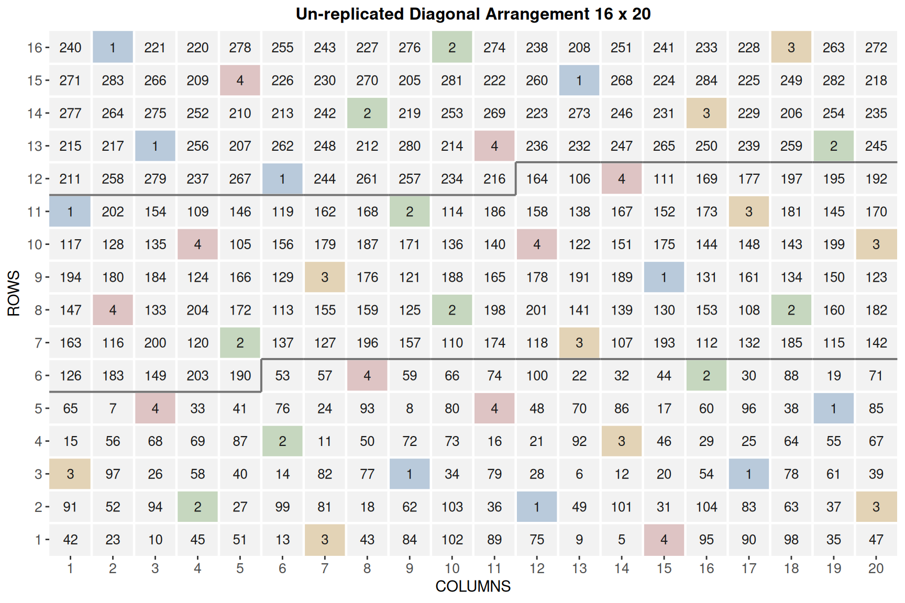
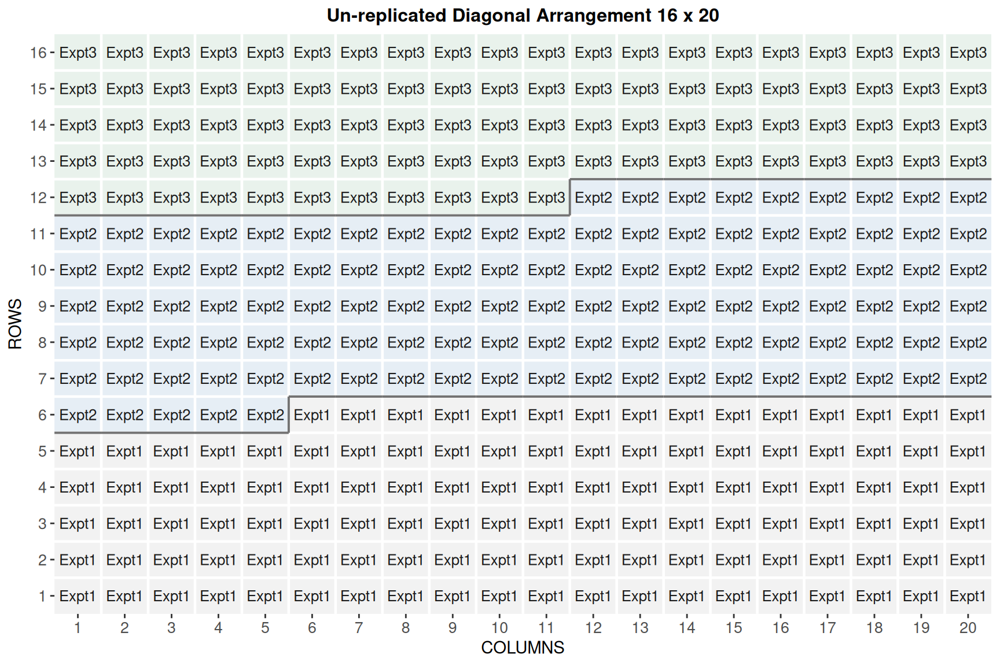
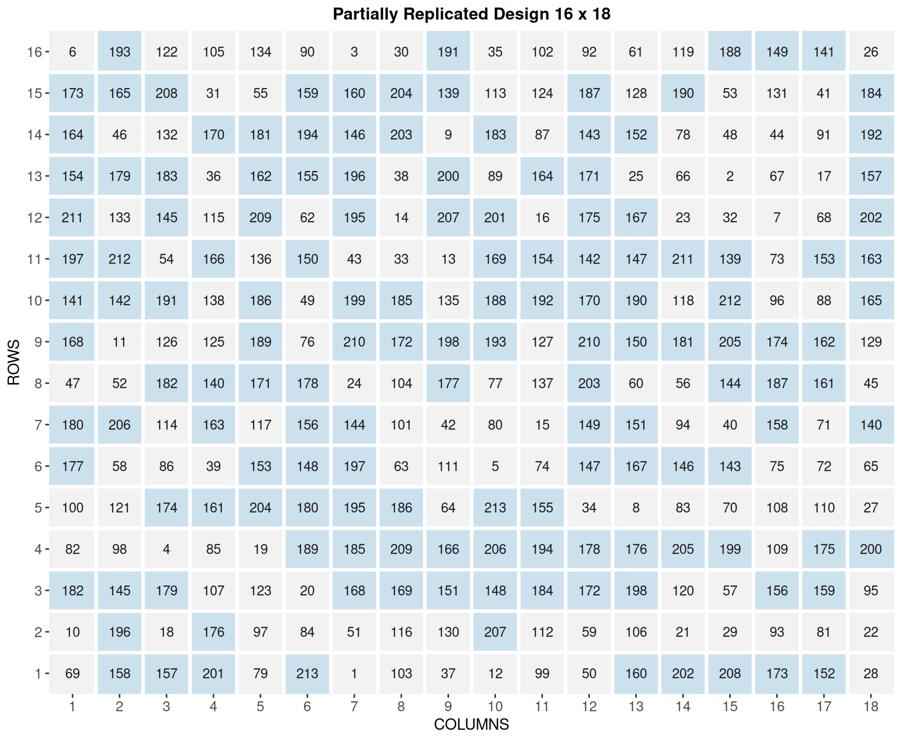

<!-- index.md is the pkgdown home page, generated from index.Rmd. Keep it in step with README.Rmd -->


# FielDHub

<!-- badges: start -->

[](https://cran.r-project.org/package=FielDHub)
[](https://github.com/DidierMurilloF/FielDHub/actions/workflows/R-CMD-check.yaml)
[](https://lifecycle.r-lib.org/articles/stages.html)
[](https://cranlogs.r-pkg.org/badges/FielDHub)
[](https://cranlogs.r-pkg.org/badges/grand-total/FielDHub)
[](https://doi.org/10.21105/joss.03122)
<!-- badges: end -->

## Design of experiments for life sciences

FielDHub is an R package and Shiny app that randomizes field, greenhouse
and laboratory experiments. It covers classic designs, such as
completely randomized, complete block, Latin square, factorial and
split-plot designs, and the unreplicated, augmented and partially
replicated designs used in plant breeding. It serves agriculture, plant
breeding, forestry, and animal and biological sciences.

Every design comes with a field map and a field book. Every design in
the app is also an R function with the same arguments, so a script can
reproduce what the app made.

## What’s new in 1.7.6

- **Spatial correlations drawn for each trial.** In `simulate()`, give
  `rho_row` and `rho_col` as a range, or leave them out, and every
  simulated trial and location gets its own correlations. The true
  values are returned in `spatial_draws`.

## What’s new in 1.7.5

- **Design-aware trait simulation.** `stats::simulate(x)` generates
  trait data for all 21 field designs using their treatment and
  experimental units.
- **Optional spatial correlation.** Simulate field variation on physical
  row and column coordinates. The Shiny app uses the same simulator for
  tables, heatmaps, and downloads.

## What’s new in 1.7.0

- **A new design.** `augmented_row_column()` builds augmented row-column
  designs, in which every check appears once in every row or every
  column of the field. It has its own page in the app under Unreplicated
  Designs.
- **One style for every field map.** One muted colour per replication or
  block, white alleys between them, grey lines around incomplete blocks,
  a white grid around every plot, and one muted colour per check.
- **Better partially replicated designs.** An optional rule keeps the
  copies of an entry in distinct rows and columns (`rowcol_penalty`),
  and the spreading optimizer is much faster.
- **A refreshed app.** New Welcome, Help and About pages: the Welcome
  page links to every design, and Help gives each design its guide,
  reference page and offline `help()` command.

See the [release notes](NEWS.md) for every change, including the changes
to results for a given seed.

## Installation

From CRAN:

``` r
install.packages("FielDHub")
```

The development version, from GitHub:

``` r
remotes::install_github("DidierMurilloF/FielDHub")
```

## Launch the app

``` r
library(FielDHub)
run_app()
```

The app’s dependencies install with the package, and it needs Shiny
1.8.1 or newer. To keep other sessions responsive while a long design
runs, install `mirai` and start the app with `run_app(workers = 2L)`.
Workers need an installed FielDHub; without `mirai`, or when running
from the package source, designs run in the app’s own session.

## Designs

FielDHub has 21 designs, grouped as in the app’s menus. Each links to
its reference page.

| Menu                         | Design                                   | R function                                                                                                  |
|:-----------------------------|:-----------------------------------------|:------------------------------------------------------------------------------------------------------------|
| Unreplicated Designs         | Single Diagonal Arrangement              | [`diagonal_arrangement()`](https://didiermurillof.github.io/FielDHub/reference/diagonal_arrangement.html)   |
|                              | Multiple Diagonal Arrangement            | [`diagonal_arrangement()`](https://didiermurillof.github.io/FielDHub/reference/diagonal_arrangement.html)   |
|                              | Optimized Arrangement                    | [`optimized_arrangement()`](https://didiermurillof.github.io/FielDHub/reference/optimized_arrangement.html) |
|                              | Augmented RCBD                           | [`RCBD_augmented()`](https://didiermurillof.github.io/FielDHub/reference/RCBD_augmented.html)               |
|                              | Augmented Row-Column                     | [`augmented_row_column()`](https://didiermurillof.github.io/FielDHub/reference/augmented_row_column.html)   |
|                              | Sparse Allocation                        | [`sparse_allocation()`](https://didiermurillof.github.io/FielDHub/reference/sparse_allocation.html)         |
| Partially Replicated Designs | Single and Multi-Location p-rep          | [`partially_replicated()`](https://didiermurillof.github.io/FielDHub/reference/partially_replicated.html)   |
|                              | Optimized Multi-Location p-rep           | [`multi_location_prep()`](https://didiermurillof.github.io/FielDHub/reference/multi_location_prep.html)     |
| Lattice Designs              | Square Lattice                           | [`square_lattice()`](https://didiermurillof.github.io/FielDHub/reference/square_lattice.html)               |
|                              | Rectangular Lattice                      | [`rectangular_lattice()`](https://didiermurillof.github.io/FielDHub/reference/rectangular_lattice.html)     |
|                              | Alpha Lattice: alpha(0,1)                | [`alpha_lattice()`](https://didiermurillof.github.io/FielDHub/reference/alpha_lattice.html)                 |
| Other Designs                | Completely Randomized Design (CRD)       | [`CRD()`](https://didiermurillof.github.io/FielDHub/reference/CRD.html)                                     |
|                              | Randomized Complete Block Designs (RCBD) | [`RCBD()`](https://didiermurillof.github.io/FielDHub/reference/RCBD.html)                                   |
|                              | Latin Square Design (LSD)                | [`latin_square()`](https://didiermurillof.github.io/FielDHub/reference/latin_square.html)                   |
|                              | Latin Rectangle Design                   | [`latin_rectangle()`](https://didiermurillof.github.io/FielDHub/reference/latin_rectangle.html)             |
|                              | Factorial Designs                        | [`full_factorial()`](https://didiermurillof.github.io/FielDHub/reference/full_factorial.html)               |
|                              | Split-Plot Design                        | [`split_plot()`](https://didiermurillof.github.io/FielDHub/reference/split_plot.html)                       |
|                              | Split-Split-Plot Design                  | [`split_split_plot()`](https://didiermurillof.github.io/FielDHub/reference/split_split_plot.html)           |
|                              | Strip-Plot Design                        | [`strip_plot()`](https://didiermurillof.github.io/FielDHub/reference/strip_plot.html)                       |
|                              | Incomplete Blocks Design (IBD)           | [`incomplete_blocks()`](https://didiermurillof.github.io/FielDHub/reference/incomplete_blocks.html)         |
|                              | Resolvable Row-Column Design (RRCD)      | [`row_column()`](https://didiermurillof.github.io/FielDHub/reference/row_column.html)                       |

## What you get

- **A field map** of every location, ready for reports.
- **A field book** with plot numbers, rows, columns and entries, to
  download and load into a database or field app.
- **Simulated data.** The app can simulate a response variable along
  with the randomization, for teaching and for testing an analysis
  before the season.
- **A reproducible record.** `write_design()` saves a design or a
  standalone replay script, `read_design()` reads it back, and
  `reproduce_design()` rebuilds it from its recorded inputs and seed.

## Example: a multiple diagonal arrangement

A project needs to test 280 genotypes in a field of 16 rows and 20
columns, split among three experiments. Four checks are placed on
diagonals across the experiments and fill 40 plots, 12.5% of the field.
To get the same design in the app and in a script, use the same seed,
here 1249.

``` r
diagonal <- diagonal_arrangement(
  nrows = 16,
  ncols = 20,
  lines = 280,
  checks = 4,
  plotNumber = 101,
  splitBy = "row",
  seed = 1249,
  kindExpt = "DBUDC",
  blocks = c(100, 100, 80),
  exptName = c("Expt1", "Expt2", "Expt3")
)
```

A summary of the design:

``` r
print(diagonal)
Un-replicated Diagonal Arrangement Design

Information on the design parameters:
List of 11
 $ rows          : num 16
 $ columns       : num 20
 $ treatments    : num [1:3] 100 100 80
 $ checks        : int 4
 $ entry_checks  :List of 1
  ..$ : int [1:4] 1 2 3 4
 $ rep_checks    :List of 1
  ..$ : num [1:4] 10 10 10 10
 $ locations     : num 1
 $ planter       : chr "serpentine"
 $ percent_checks: chr "12.5%"
 $ fillers       : num 0
 $ seed          : num 1249

 10 First observations of the data frame with the diagonal_arrangement field book: 
   ID  EXPT LOCATION YEAR PLOT ROW COLUMN CHECKS ENTRY TREATMENT
1   1 Expt1        1 2026  101   1      1      0    42    Gen-42
2   2 Expt1        1 2026  102   1      2      0    23    Gen-23
3   3 Expt1        1 2026  103   1      3      0    10    Gen-10
4   4 Expt1        1 2026  104   1      4      0    45    Gen-45
5   5 Expt1        1 2026  105   1      5      0    51    Gen-51
6   6 Expt1        1 2026  106   1      6      0    13    Gen-13
7   7 Expt1        1 2026  107   1      7      3     3   Check-3
8   8 Expt1        1 2026  108   1      8      0    43    Gen-43
9   9 Expt1        1 2026  109   1      9      0    84    Gen-84
10 10 Expt1        1 2026  110   1     10      0   102   Gen-102
```

The first 12 rows of the field book:

``` r
head(diagonal$fieldBook, 12)
   ID  EXPT LOCATION YEAR PLOT ROW COLUMN CHECKS ENTRY TREATMENT
1   1 Expt1        1 2026  101   1      1      0    42    Gen-42
2   2 Expt1        1 2026  102   1      2      0    23    Gen-23
3   3 Expt1        1 2026  103   1      3      0    10    Gen-10
4   4 Expt1        1 2026  104   1      4      0    45    Gen-45
5   5 Expt1        1 2026  105   1      5      0    51    Gen-51
6   6 Expt1        1 2026  106   1      6      0    13    Gen-13
7   7 Expt1        1 2026  107   1      7      3     3   Check-3
8   8 Expt1        1 2026  108   1      8      0    43    Gen-43
9   9 Expt1        1 2026  109   1      9      0    84    Gen-84
10 10 Expt1        1 2026  110   1     10      0   102   Gen-102
11 11 Expt1        1 2026  111   1     11      0    89    Gen-89
12 12 Expt1        1 2026  112   1     12      0    75    Gen-75
```

The field map. Each check has its own muted colour and appears
throughout the field; the grey lines mark where each experiment starts
and ends.

``` r
plot(diagonal)
```



The same field by experiment:

``` r
plot(diagonal, text.string = "EXPT")
```



In the app you can also choose how many filler plots to add and where.
The R function adds fillers only when the experiments do not fill the
field.

More examples are in the [diagonal arrangement
article](https://didiermurillof.github.io/FielDHub/articles/diagonal_arrangement.html).

## Example: a partially replicated design

Partially replicated (p-rep) designs are common in early-generation
trials: some entries are replicated and the rest appear once. Here 75
entries appear twice and 138 entries once, in a field of 16 rows and 18
columns (288 plots), with seed 77.

``` r
pREP <- partially_replicated(
  nrows = 16,
  ncols = 18,
  repGens = c(138, 75),
  repUnits = c(1, 2),
  planter = "serpentine",
  plotNumber = 1,
  exptName = "ExptA",
  locationNames = "FARGO",
  seed = 77
)
```

A summary of the design:

``` r
print(pREP)
Partially Replicated Design 

Replications within location: 
  LOCATION Replicated Unreplicated
1    FARGO         75          138

 Information on the design parameters: 
List of 10
 $ rows              : num 16
 $ columns           : num 18
 $ min_distance      : num 5
 $ incidence_in_rows : num 1
 $ locations         : num 1
 $ planter           : chr "serpentine"
 $ experimental_plots: num 288
 $ field_capacity    : num 288
 $ fillers           : num 0
 $ seed              : num 77

 10 First observations of the data frame with the partially_replicated field book: 
# A tibble: 10 × 11
      ID EXPT  LOCATION YEAR   PLOT   ROW COLUMN   REP CHECKS ENTRY TREATMENT
   <int> <chr> <chr>    <chr> <dbl> <int>  <int> <int>  <dbl> <dbl> <chr>    
 1     1 ExptA FARGO    2026      1     1      1     1      0    69 G69      
 2     2 ExptA FARGO    2026      2     1      2     1    158   158 G158     
 3     3 ExptA FARGO    2026      3     1      3     1    157   157 G157     
 4     4 ExptA FARGO    2026      4     1      4     1    201   201 G201     
 5     5 ExptA FARGO    2026      5     1      5     1      0    79 G79      
 6     6 ExptA FARGO    2026      6     1      6     1    213   213 G213     
 7     7 ExptA FARGO    2026      7     1      7     1      0     1 G1       
 8     8 ExptA FARGO    2026      8     1      8     1      0   103 G103     
 9     9 ExptA FARGO    2026      9     1      9     1      0    37 G37      
10    10 ExptA FARGO    2026     10     1     10     1      0    12 G12      
```

The first 12 rows of the field book:

``` r
head(pREP$fieldBook, 12)
# A tibble: 12 × 11
      ID EXPT  LOCATION YEAR   PLOT   ROW COLUMN   REP CHECKS ENTRY TREATMENT
   <int> <chr> <chr>    <chr> <dbl> <int>  <int> <int>  <dbl> <dbl> <chr>    
 1     1 ExptA FARGO    2026      1     1      1     1      0    69 G69      
 2     2 ExptA FARGO    2026      2     1      2     1    158   158 G158     
 3     3 ExptA FARGO    2026      3     1      3     1    157   157 G157     
 4     4 ExptA FARGO    2026      4     1      4     1    201   201 G201     
 5     5 ExptA FARGO    2026      5     1      5     1      0    79 G79      
 6     6 ExptA FARGO    2026      6     1      6     1    213   213 G213     
 7     7 ExptA FARGO    2026      7     1      7     1      0     1 G1       
 8     8 ExptA FARGO    2026      8     1      8     1      0   103 G103     
 9     9 ExptA FARGO    2026      9     1      9     1      0    37 G37      
10    10 ExptA FARGO    2026     10     1     10     1      0    12 G12      
11    11 ExptA FARGO    2026     11     1     11     1      0    99 G99      
12    12 ExptA FARGO    2026     12     1     12     1      0    50 G50      
```

The field map. Replicated entries are on soft blue and the rest on light
grey.

``` r
plot(pREP)
```



More examples are in the [partially replicated
article](https://didiermurillof.github.io/FielDHub/articles/partially_replicated.html).

## For teaching

FielDHub is used in courses on statistics, experimental design and plant
breeding. Students see the randomization, the field layout and the data
in one place; simulated responses give them a data set to analyse from
the first class; and because every design is an R function with a seed,
an assignment can give each student the same randomization, or a
different one.

## Documentation and help

- The [FielDHub website](https://didiermurillof.github.io/FielDHub/) has
  a guide for every design, worked examples and the function reference.
- In R, `help("diagonal_arrangement", package = "FielDHub")` and the
  other help pages work offline.
- [Video
  tutorials](https://www.youtube.com/channel/UC4i3oTcU58Za42DbWwqF9Kg)
  walk through the app.
- Found a bug or missing a design? [Open an
  issue](https://github.com/DidierMurilloF/FielDHub/issues).

## Citation

If you use FielDHub, please cite the paper in the Journal of Open Source
Software. Run `citation("FielDHub")` in R for the reference.

## Contributing

Contributions are welcome; see the [contributing guide](CONTRIBUTING.md)
and the [code of conduct](CODE_OF_CONDUCT.md).

FielDHub is developed at [Agricultural Data
Analytics](https://www.ndsu.edu/agricultural-data-analytics), North
Dakota State University.
